# Laporan Evidence Praktikum: REST API Produk dengan Prisma ORM

**Identitas Mahasiswa:**
- **Nama:** Muhammad Rifqi Fathurrahman
- **NRP:** 5027251029
- **Mata Kuliah:** Pemrograman Web (PWeb)
- **Topik Penugasan:** Integrasi Prisma ORM pada Express.js REST API (CRUD & Validasi)

---

## 📌 Ringkasan Pengerjaan

Penugasan ini merupakan kelanjutan dari proyek REST API Express.js produk sebelumnya yang semula menggunakan penyimpanan *in-memory array*, kini ditingkatkan menggunakan **Prisma ORM** dengan database engine SQLite.

Fitur-fitur utama yang telah diimplementasikan:
1. **GET**: Menampilkan seluruh data produk (`GET /products`) serta mengambil produk berdasarkan ID (`GET /products/:id`).
2. **POST**: Membuat data produk baru ke database (`POST /products`).
3. **PUT**: Mengupdate data produk yang sudah ada di database (`PUT /products` atau `PUT /products/:id`), di mana *request body* sama dengan *body* POST namun terdapat tambahan properti `id`.
4. **DELETE**: Menghapus data produk yang sudah ada berdasarkan ID (`DELETE /products/:id`).
5. **Data Validation & Error Handling**: Penanganan validasi input (field kosong, tipe data salah, nilai negatif) dan HTTP Status Code yang tepat (`200 OK`, `201 Created`, `400 Bad Request`, `404 Not Found`, `500 Internal Server Error`).

---

## 🗄️ Model Database (Prisma Schema)

File skema database berada di `prisma/schema.prisma`:
```prisma
datasource db {
  provider = "sqlite"
  url      = env("DATABASE_URL")
}

generator client {
  provider = "prisma-client-js"
}

model Product {
  id        Int      @id @default(autoincrement())
  name      String
  price     Int
  createdAt DateTime @default(now())
  updatedAt DateTime @updatedAt
}
```

---

## 📋 Matriks Pengujian Skenario API

| No | Skenario | Method | Endpoint | HTTP Status | Keterangan |
|---|---|---|---|---|---|
| 1 | GET All Products | `GET` | `/products` | `200 OK` | Mengambil seluruh record data awal |
| 2 | POST Create Product (Success) | `POST` | `/products` | `201 Created` | Menambahkan produk "Penggaris" (Rp 3.000) |
| 3 | POST Validation: Empty Name | `POST` | `/products` | `400 Bad Request` | Gagal validasi: field `name` kosong |
| 4 | POST Validation: Negative Price | `POST` | `/products` | `400 Bad Request` | Gagal validasi: field `price` bernilai negatif |
| 5 | GET Product by ID (Success) | `GET` | `/products/1` | `200 OK` | Mengambil data produk dengan ID 1 |
| 6 | GET Product by ID (Not Found) | `GET` | `/products/999` | `404 Not Found` | ID tidak ada di database |
| 7 | PUT Update Product (Success) | `PUT` | `/products` | `200 OK` | Update ID 1: "Buku Tulis Sinar Dunia" (Rp 18.000) |
| 8 | PUT Validation: Missing ID | `PUT` | `/products` | `400 Bad Request` | Gagal validasi: field `id` tidak disertakan |
| 9 | PUT Update Not Found | `PUT` | `/products` | `404 Not Found` | Gagal update: ID 999 tidak ditemukan |
| 10 | DELETE Product by ID (Success) | `DELETE` | `/products/2` | `200 OK` | Menghapus produk ID 2 ("Pulpen") |
| 11 | DELETE Product Not Found | `DELETE` | `/products/999` | `404 Not Found` | Gagal hapus: ID 999 tidak ditemukan |
| 12 | GET All Products (Final State) | `GET` | `/products` | `200 OK` | Verifikasi state akhir data di database |

---

## 📸 Bagian 1: Bukti Pengujian Skenario API (API Client / Postman)

### 1. GET `/products` — Menampilkan Seluruh Data Produk (Awal)
- **Tujuan:** Memverifikasi pengambilan seluruh data awal hasil seeding database (`Buku` dan `Pulpen`).
- **Status:** `200 OK`

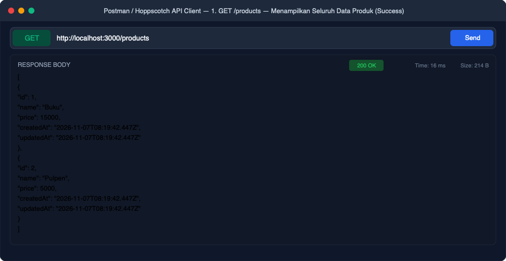

---

### 2. POST `/products` — Membuat Data Produk Baru (Success)
- **Tujuan:** Menguji penambahan data baru ke dalam database SQLite melalui Prisma.
- **Request Body:**
  ```json
  {
    "name": "Penggaris",
    "price": 3000
  }
  ```
- **Status:** `201 Created`

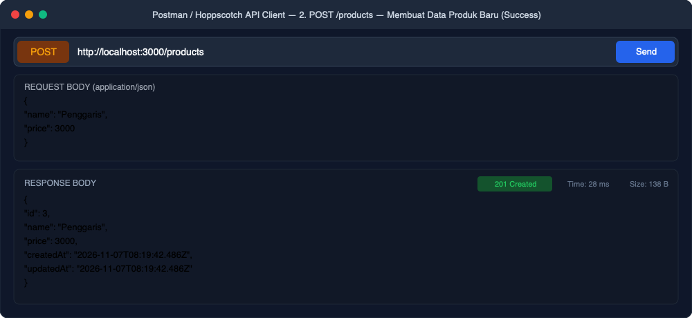

---

### 3. POST `/products` — Validasi: Field `name` Kosong
- **Tujuan:** Memastikan API menolak pembuatan produk jika field `name` berupa string kosong.
- **Request Body:**
  ```json
  {
    "name": "",
    "price": 3000
  }
  ```
- **Status:** `400 Bad Request`

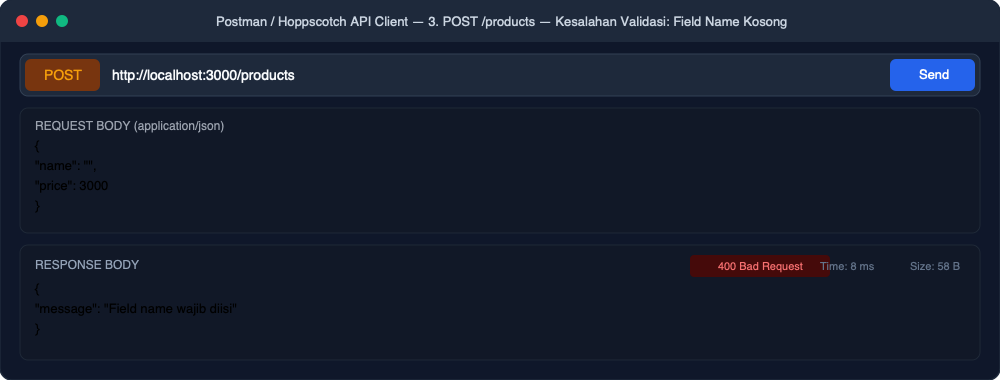

---

### 4. POST `/products` — Validasi: Field `price` Tidak Valid / Negatif
- **Tujuan:** Memastikan API memvalidasi nilai harga tidak boleh berupa angka negatif.
- **Request Body:**
  ```json
  {
    "name": "Penghapus",
    "price": -500
  }
  ```
- **Status:** `400 Bad Request`

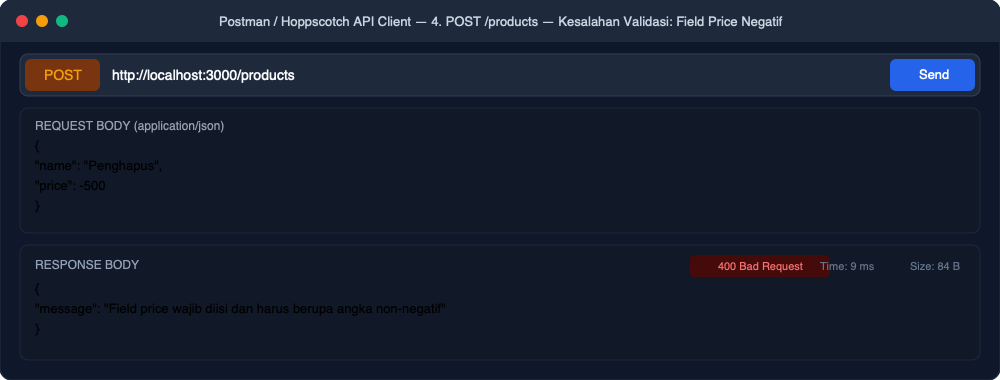

---

### 5. GET `/products/:id` — Mengambil Data Produk Berdasarkan ID (Success)
- **Tujuan:** Mengambil detail satu record produk yang tersimpan di database berdasarkan parameter ID.
- **Status:** `200 OK`

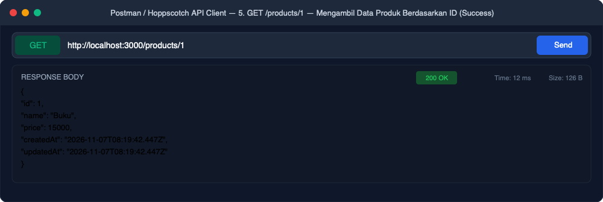

---

### 6. GET `/products/:id` — Data Produk Tidak Ditemukan (404 Not Found)
- **Tujuan:** Menguji respon error ketika ID yang diminta tidak terdaftar di database.
- **Status:** `404 Not Found`

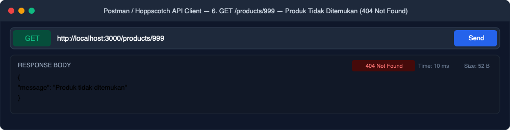

---

### 7. PUT `/products` — Mengupdate Data (Body Sama dengan POST + ID) (Success)
- **Tujuan:** Memenuhi spesifikasi: *body sama dengan POST namun ada tambahan id*. Mengupdate produk ID 1 menjadi "Buku Tulis Sinar Dunia" seharga Rp 18.000.
- **Request Body:**
  ```json
  {
    "id": 1,
    "name": "Buku Tulis Sinar Dunia",
    "price": 18000
  }
  ```
- **Status:** `200 OK`

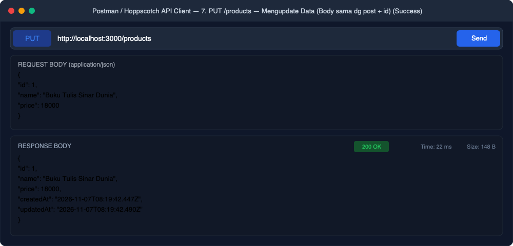

---

### 8. PUT `/products` — Validasi: Field `id` Tidak Disertakan
- **Tujuan:** Memastikan pemanggilan PUT tanpa menyertakan ID pada body maupun URL ditolak oleh API.
- **Request Body:**
  ```json
  {
    "name": "Buku Tanpa ID",
    "price": 20000
  }
  ```
- **Status:** `400 Bad Request`

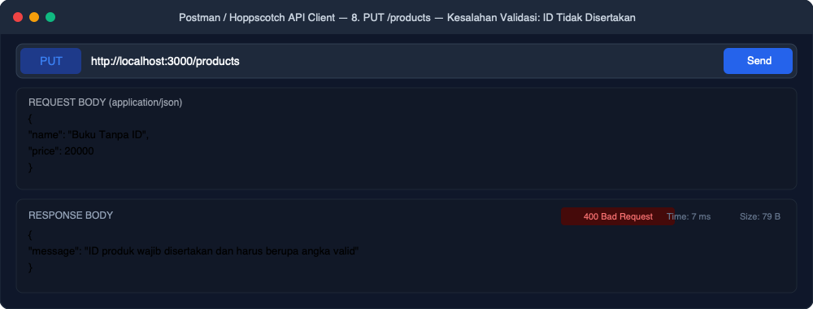

---

### 9. PUT `/products` — Mengupdate Produk Tidak Terdaftar (404 Not Found)
- **Tujuan:** Memastikan API mengembalikan error 404 ketika ID yang hendak di-update tidak ditemukan di database.
- **Request Body:**
  ```json
  {
    "id": 999,
    "name": "Barang Gaib",
    "price": 99999
  }
  ```
- **Status:** `404 Not Found`

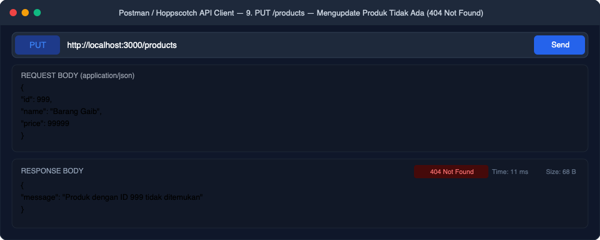

---

### 10. DELETE `/products/:id` — Menghapus Produk Berdasarkan ID (Success)
- **Tujuan:** Menghapus data produk ID 2 ("Pulpen") dari database melalui Prisma ORM.
- **Status:** `200 OK`

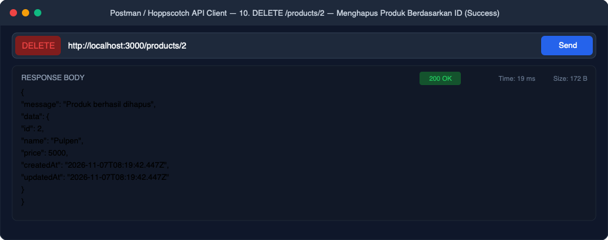

---

### 11. DELETE `/products/:id` — Menghapus Produk Tidak Terdaftar (404 Not Found)
- **Tujuan:** Memverifikasi API mengembalikan error 404 ketika mencoba menghapus ID yang tidak ada.
- **Status:** `404 Not Found`

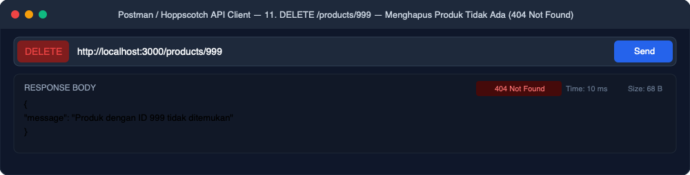

---

### 12. GET `/products` — Verifikasi State Data Akhir di Database
- **Tujuan:** Memverifikasi seluruh operasi CRUD telah tercermin dengan benar di database:
  - ID 1 telah berubah namanya menjadi `Buku Tulis Sinar Dunia` dan harganya `18000`.
  - ID 2 (`Pulpen`) telah terhapus.
  - ID 3 (`Penggaris`, `3000`) baru ditambahkan.
- **Status:** `200 OK`


---

## 🗄️ Bagian 2: Bukti Perubahan Database (Before - After)

### 1. Perubahan Database pada Operasi POST (Insert Data Baru)
- **Deskripsi:** Sebelum operasi POST, tabel `Product` hanya memiliki 2 baris (`Buku` dan `Pulpen`). Setelah operasi `POST /products` dengan payload `{"name": "Penggaris", "price": 3000}`, record baru dengan ID 3 berhasil masuk ke database.

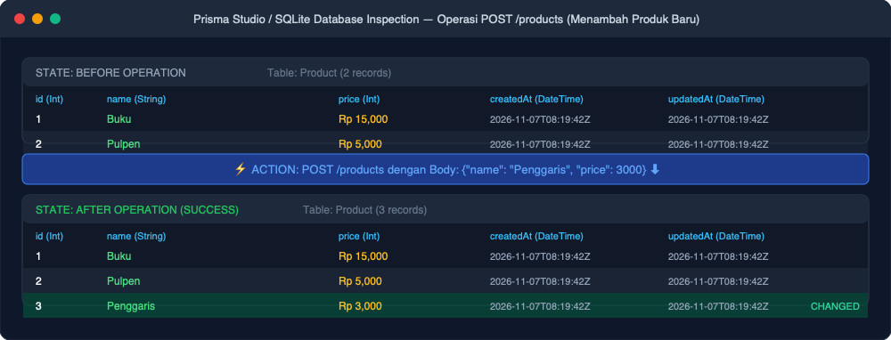

---

### 2. Perubahan Database pada Operasi PUT (Update Data)
- **Deskripsi:** Sebelum operasi PUT, record dengan ID 1 memiliki data `name: "Buku"` dan `price: 15000`. Setelah operasi `PUT /products` dengan payload `{"id": 1, "name": "Buku Tulis Sinar Dunia", "price": 18000}`, nilai `name`, `price`, serta timestamp `updatedAt` pada ID 1 diperbarui langsung pada database.

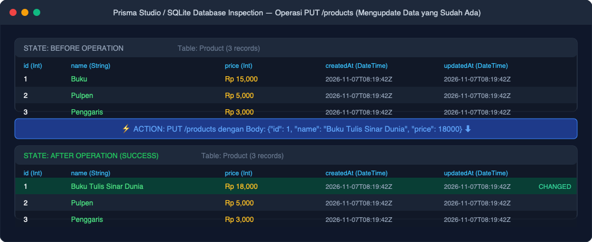

---

### 3. Perubahan Database pada Operasi DELETE (Hapus Data)
- **Deskripsi:** Sebelum operasi DELETE, tabel memiliki 3 baris termasuk ID 2 (`Pulpen`). Setelah operasi `DELETE /products/2`, baris ID 2 secara permanen terhapus dari tabel database.

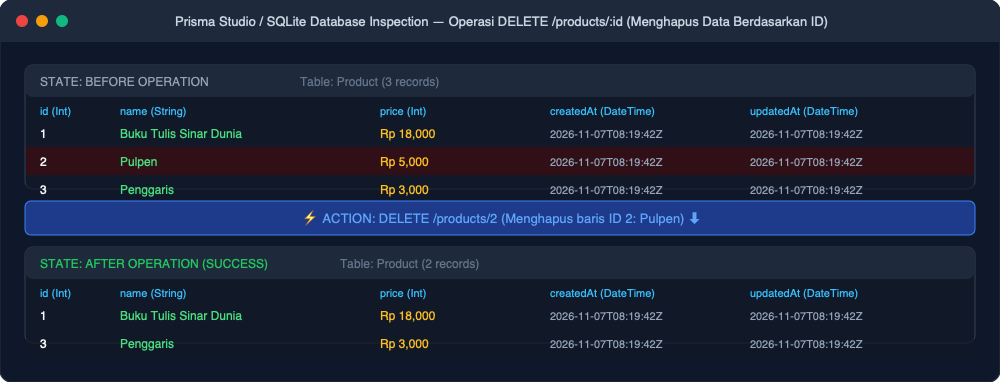

---

## 🚀 Kesimpulan

Implementasi Prisma ORM pada REST API Express.js telah berhasil diselesaikan secara menyeluruh:
1. Skema database `Product` dikelola menggunakan Prisma dengan field `id`, `name`, `price`, `createdAt`, dan `updatedAt`.
2. Seluruh endpoint HTTP (`GET`, `POST`, `PUT`, `DELETE`) bekerja secara reaktif dan aman terhadap database SQLite.
3. Fitur PUT secara fleksibel mendukung format *body* sama dengan POST ditambah atribut `id` sesuai instruksi penugasan.
4. Validasi input dan respon status HTTP terstandarisasi untuk skenario sukses maupun gagal.
